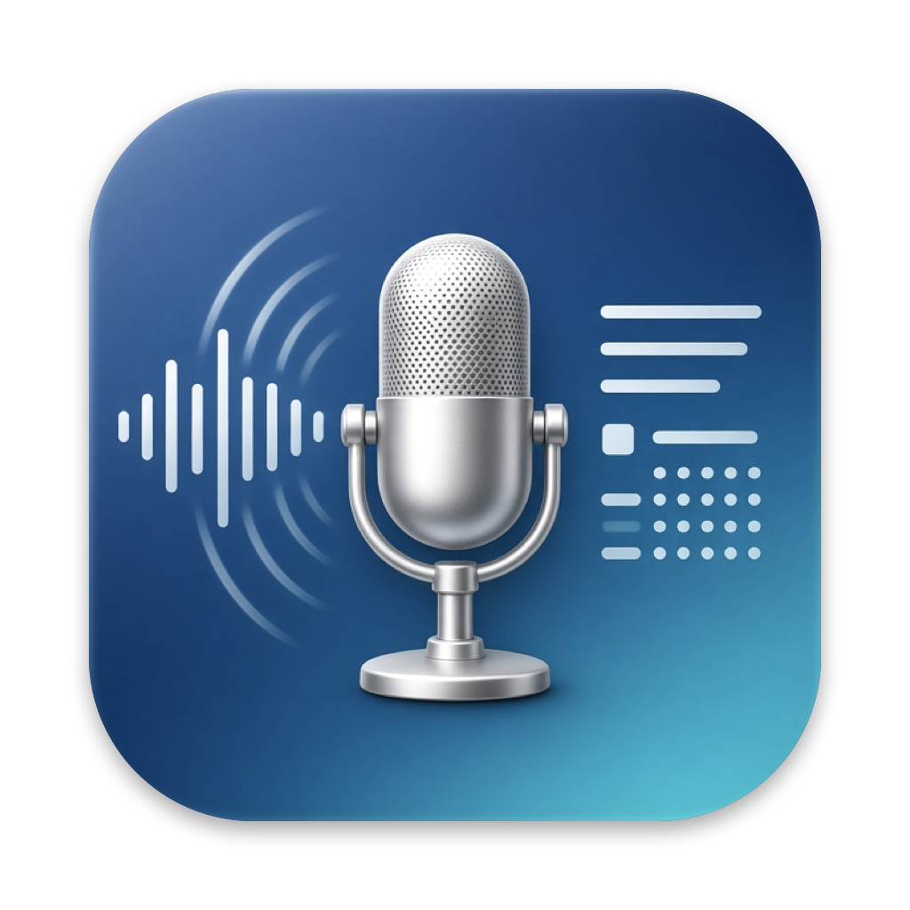

# Call Transcriber



A Mac app that records your calls and turns them into word-for-word transcripts, with you and the other person
as separate speakers. Press **Record** when the call starts and **Stop** when it ends: a PDF and a Word (DOCX)
transcript follow on their own.

Everything runs on your Mac. Nothing is uploaded.

- **Your sound card, fixed.** In Settings > Recording choose input 1 (a sound card and one of its channels, say
  channel 1 of a Scarlett) and, if you like, input 2 (another sound card or microphone). Each stays on its
  device even if the Mac's default input changes during the call. Both are recorded on their own and combined
  into one recording. **Test** shows a meter for each input before the call.
- **Who's who, two ways** (Settings > Recording):
  - *One recording, voices told apart* (the default): records the sound card only and labels Person 1,
    Person 2… Use this when the sound card hears everyone, as with a mixer, a room or a speakerphone.
  - *Two tracks:* the sound card is you, and everything the Mac plays is the other side. Use this with headphones.
- **Both sides, kept apart** (two-track mode). Your microphone and the Mac's sound (the other side: Zoom, FaceTime, Teams,
  Google Meet in a browser, phone calls through your iPhone, and so on) are recorded as two tracks. So the
  transcript knows who said what: "Me" and "Client", or names you choose. If several people were on the
  other side, their voices are told apart too.
- **Word for word.** Every "um", "uh", false start and repeated word is kept.
- **Without headphones too.** When the microphone also hears the other person through the speakers, those
  words are recognised as an echo and left out of your side.
- **One recording per call.** `Call.m4a` has both sides together, to listen back to; `Me.caf` and `Them.caf`
  keep each side on its own.
- **Visible while recording.** A red recording box with the time and a level meter for each side, a red dot and
  the time in the menu bar, and "REC" on the Dock icon.
- **Rename** the call (say, after the client) and the speakers: the saved files are written again.
- Recordings and videos made elsewhere can be dropped in to be transcribed as well.
- **Toolbar:** record, pause, stop, add files, the output folder, verbose mode, settings, donate, and a coffee
  cup that keeps the Mac awake.

## Recording calls and consent

In many places everyone on a call must agree to it being recorded. California, for example, is a two-party
(all-party) consent state, and recording without consent there is a crime. Other US states, countries and
workplaces have their own rules. Before you record, tell the other person, or paste the notice into the call's
chat (**Copy notice** sits next to the recording timer; edit its words in Settings). The app reminds you before
recording until you turn the reminder off.

## Needs

- macOS 14.4 or newer on Apple Silicon (M1 or later) to record calls. Transcribing files works from macOS 14.
- The first time you record, macOS asks for two permissions: **Microphone** (your side) and **System Audio
  Recording** (the other side). Both can be changed in System Settings > Privacy & Security.

## Where things are saved

- Transcripts: `~/Call Transcripts` (change it in Settings)
- Recordings: `~/Call Transcripts/Recordings/Call 2026-10-28 14.05/` with `Call.m4a` (everything combined),
  `Input.caf` and `Input 2.caf` (each input), and in two-track mode `Them.caf` (the other side) and `Me.m4a`

## How it works

1. **Recording.** The microphone through AVAudioEngine; the Mac's sound through a Core Audio process tap, a copy
   of what every app plays before it reaches the speakers or headphones. Each side goes to its own file (AAC),
   and both start at the same moment.
2. **Listening.** NVIDIA's Parakeet speech recognition ("ultra" build) hears each side on its own, with the time
   of each word, on the Mac's Neural Engine.
3. **Putting it together.** Words the microphone picked up from the speakers are left out, each side is cut into
   stretches at sentence ends and pauses, and the stretches are laid out in the order they were said.
4. With more than one person on the other side, pyannote's speaker models tell their voices apart.

The speech and voice models run through [FluidAudio](https://github.com/FluidInference/FluidAudio). A copy of it
lives in `app/Vendor/FluidAudio` with a fix for macOS 14 (see `VENDORED.md` there). The engine is shared with
[Transcript Maker](https://github.com/TechnAudioToolz/video-audio-to-transcript).

**No transcript is perfect.** Expect slips with poor connections, people talking over each other, heavy accents
and unusual names. The timestamps make it quick to check a passage against the recording.

## Build

```bash
cd app
./build.sh --open
```

Then drag `app/build/Call Transcriber.app` to Applications. The first transcript downloads the models (about
650 MB, once) into `~/Library/Application Support/Transcript Maker/models`, shared with Transcript Maker.

The app is signed on your own Mac without an Apple Developer account, so macOS asks again for the microphone
and system audio permissions after each new build.

From Terminal, the same engine:

```bash
app/.build/release/transcribe-cli --me Me.caf --them Them.caf --title "Client call" --out ~/Desktop
```

## License

MIT. Parakeet (CC-BY-4.0, NVIDIA), FluidAudio (Apache 2.0) and the pyannote models keep their own licenses.
